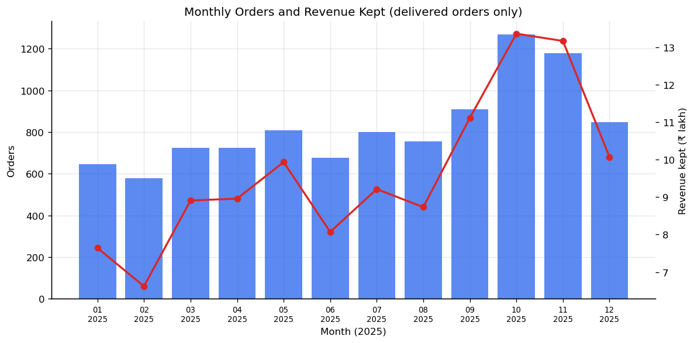
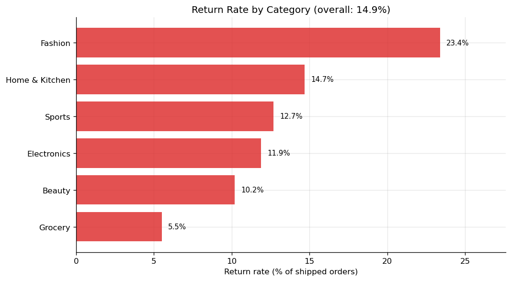
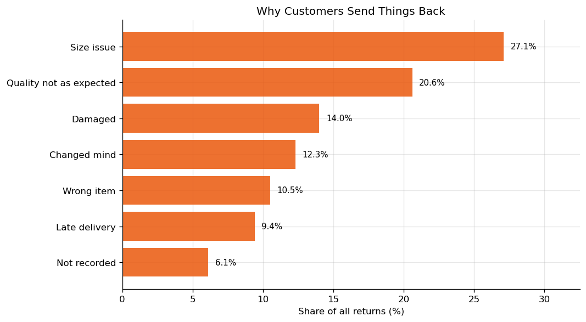
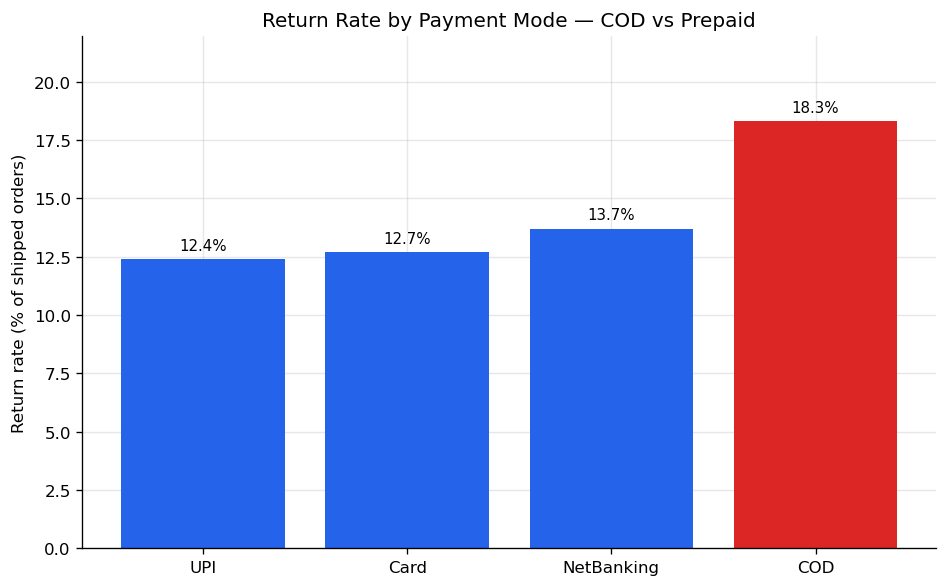
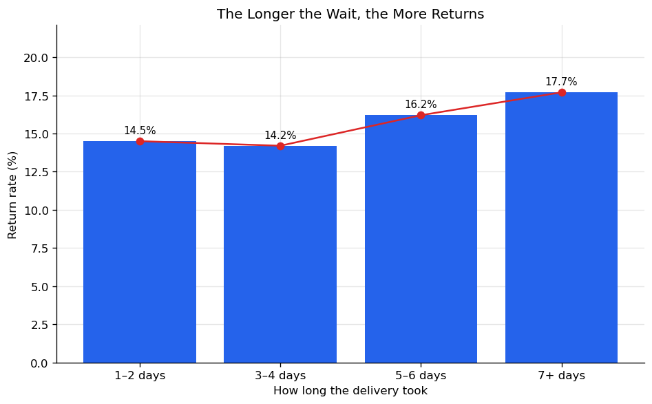
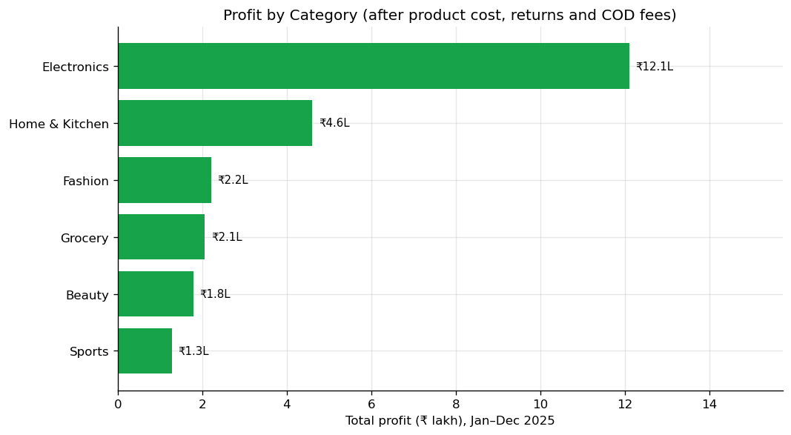

# Indian E-Commerce Sales & Returns Analysis 🛒

Hi, I'm **Vivek Saini** — a Data Analyst from Meerut, India. This is my
second portfolio project. The first one was about the job market; this one
is about a business problem I find very real: **an online seller who gets
plenty of orders but keeps very little profit.**

> 📓 **Start here:** the full analysis, step by step with charts and
> commentary, is in **[ecommerce_analysis.ipynb](ecommerce_analysis.ipynb)**.
> The scripts below reproduce everything.

## The problem I wanted to solve

A mid-size Indian online seller sells on his own store across 14 cities.
Sales look healthy. But month after month, the profit is thin, and the
owner does not know exactly why. He has four doubts:

- *"Too many products come back as returns."*
- *"COD orders are more trouble than prepaid ones."*
- *"We give big discounts in sale months, but I don't know if we earn from them."*
- *"Some cities are slow to deliver, and I think that hurts us."*

I took one full year of his orders (Jan–Dec 2025) and tested each doubt
with data. Guesses are free — I wanted numbers.

## A quick, honest note about the data

This dataset is **made by me with Python** (`generate_data.py`, seed 42) —
it is not a real company's data, and I am not going to pretend it is. What
I did was build it to behave like real Indian e-commerce: fashion comes
back for size issues, COD orders behave differently from prepaid ones,
October–November festival sales spike, and a few cities get slow delivery.
The raw file is also messy on purpose — mixed date formats, city names
written 4–5 different ways, missing values, duplicate rows — because real
exports look exactly like that, and cleaning is half of a data analyst's
job. Every step here (cleaning, profit model, pandas, SQL, charts) is the
same work I would do on a real file.

## The dataset at a glance

| | |
|---|---|
| **Raw rows** | 10,045 (with 45 exact duplicates and some missing values) |
| **Clean rows analysed** | 9,920 |
| **Period** | Jan–Dec 2025 |
| **Cities** | 14 — Delhi, Mumbai, Bengaluru, Hyderabad, Chennai, Pune, Kolkata, Ahmedabad, Jaipur, Lucknow, Indore, Patna, Kochi, Surat |
| **Categories** | Electronics, Fashion, Home & Kitchen, Beauty, Sports, Grocery |
| **Payment modes** | COD, UPI, Card, NetBanking |
| **Columns** | order id, date, customer, city, state, category, product, quantity, price, discount %, payment mode, delivery days, status, return reason, shipping fee, order value |

**Status mix:** Delivered 7,934 · Returned
1,394 · Cancelled 592

## How I worked out profit

Sales value is not profit. I gave every order a simple profit number with
open assumptions:

- **Product cost** = 62% of the listed price (quantity × unit price, before discount)
- **Return shipping** = ₹180 per returned order, paid by the seller
- **COD handling fee** = ₹45 per delivered COD order
- **Delivered order:** profit = order value + shipping fee − product cost − COD fee (if COD)
- **Returned order:** full refund, so profit = −₹180
- **Cancelled order:** profit = ₹0

With that model, the year looks like this: revenue kept
**₹1.16 crore**, total profit **₹24.0 lakh**
— a **20.8% margin**. Now, where does the rest go?



## What I found

### 1. Returns are the biggest leak

**14.9% of shipped orders came back** —
1,394 returns in one year. Just the return shipping cost
₹2.5 lakh, and that is before counting the lost sales
themselves.

| Category | Orders | Return rate | Profit | Margin |
|---|---:|---:|---:|---:|
| Electronics | 2,376 | 11.9% | ₹12.1 lakh | 26.3% |
| Home & Kitchen | 1,802 | 14.7% | ₹4.6 lakh | 19.9% |
| Fashion | 2,852 | 23.4% | ₹2.2 lakh | 8.9% |
| Grocery | 979 | 5.5% | ₹2.1 lakh | 30.1% |
| Beauty | 1,126 | 10.2% | ₹1.8 lakh | 23.4% |
| Sports | 785 | 12.7% | ₹1.3 lakh | 17.6% |

**Fashion is the problem child.** It is the second-biggest category by
orders, but it keeps the least money for its size — a 8.9%
margin against 26.3% for Electronics. And the reason is
sitting in the return reasons:

| Return reason | Share of all returns |
|---|---:|
| Size issue | 27.1% |
| Quality not as expected | 20.6% |
| Damaged | 14.0% |
| Changed mind | 12.3% |
| Wrong item | 10.5% |
| Late delivery | 9.4% |
| Not recorded | 6.1% |

**"Size issue" is the #1 reason (27.1% of all returns).**
That is not a factory problem — that is a size-chart problem, and it can be
fixed on the product page.




### 2. COD costs more than it looks

| Payment mode | Return rate |
|---|---:|
| COD | 18.3% |
| NetBanking | 13.7% |
| Card | 12.7% |
| UPI | 12.4% |

COD orders come back **18.3%** of the time; prepaid
orders **12.7%**. On top of that, every delivered COD order
pays a ₹45 handling fee. The weakest mix in the whole business is
**Fashion + COD**: 1,174 orders that earned
only about **₹40 per order** on average. The owner's
doubt about COD was right.



### 3. Deep discounts lose money — and October proves it

| Discount | Orders | Return rate in band | Avg profit per order |
|---|---:|---:|---:|
| 0–10% | 1,930 | 10.2% | ₹466 |
| 10–25% | 4,934 | 13.9% | ₹278 |
| 25–40% | 2,804 | 19.3% | ₹58 |
| 40%+ | 252 | 23.4% | ₹-106 |

At a small discount, an order earns about ₹466. At
40%+, the seller **loses about ₹106 on every order**.
This surprised me the most in the whole project: **October had the most
orders of the year (1,269) and the most revenue
(₹13.4 lakh), but its profit (₹1.9 lakh) was lower
than May** (₹2.3 lakh from only 808 orders). The
festival sale sold more and earned less. More orders is not the same thing
as more money.

### 4. Slow delivery means more returns

| Delivery time | Return rate |
|---|---:|
| 1–2 days | 14.5% |
| 3–4 days | 14.2% |
| 5–6 days | 16.2% |
| 7+ days | 17.7% |

The slower the delivery, the more returns — every single step. The worst
city is **Patna**: 17.7% returns with
5.8 days average delivery. The best is
Delhi at 13.3%. Fast delivery is not
just good service; it directly cuts returns.



### 5. Electronics quietly pays the bills

Electronics is not the biggest category by orders, but it earns the most
profit — ₹12.1 lakh of the ₹24.0 lakh total — because
its prices are higher and its return rate is much lower than Fashion's.



**Most profit per product (100+ orders):**

| Product | Orders | Profit |
|---|---:|---:|
| Smart Watch | 411 | ₹3.6 lakh |
| Headphones | 416 | ₹2.7 lakh |
| Mixer Grinder | 312 | ₹2.2 lakh |
| Wireless Earbuds | 364 | ₹2.1 lakh |
| Bluetooth Speaker | 393 | ₹1.9 lakh |

**Least profit per product (100+ orders):**

| Product | Orders | Profit |
|---|---:|---:|
| Gym Gloves | 155 | ₹0.1 lakh |
| Men's Cotton T-Shirt | 495 | ₹0.2 lakh |
| Yoga Mat 6mm | 168 | ₹0.2 lakh |
| Sunscreen SPF 50 | 203 | ₹0.2 lakh |
| Herbal Shampoo | 211 | ₹0.2 lakh |

## Checking my work with SQL

I loaded the cleaned data into SQLite inside the notebook and asked five
business questions in SQL — top cities by revenue, return rate by category,
monthly revenue and profit, best and worst products by profit, and a COD vs
prepaid comparison. The SQL answers matched my pandas answers, which is
exactly the kind of double-check I want before showing numbers to anyone.

## What the business should do

1. **Fix the fashion size charts first.** Clear size charts, a "check your
   size" note, and real fit photos on fashion pages. Size is the #1 return
   reason, and fashion gets the most traffic — even a small drop here is
   worth a lot of money.
2. **Push prepaid, gently.** Free shipping or a small extra discount on
   prepaid orders. Every order that moves from COD to prepaid is less
   likely to come back and also saves the ₹45 handling fee.
3. **Put a floor under discounts.** Keep most discounts at or below 25%.
   In this data, 40%+ discounts lost money on almost every order.
4. **Speed up the slow cities.** A closer warehouse or a faster courier
   for Patna and the other slow cities. Delivery speed and
   returns move together, so this pays twice.
5. **Be careful with Fashion + COD.** A small advance payment on COD
   fashion orders would filter out the least serious orders in the weakest
   mix in the business.
6. **Judge sale months by profit, not orders.** October looked like the
   best month and was not. The report the owner should see every month is
   profit by category — not just sales.

## What I learned building this

- **Cleaning is real work.** Mixed date formats, one city written five
  ways, missing prices — the analysis was the easy part.
- **A return is worse than a lost sale.** It is a lost sale *plus* a
  shipping bill. Profit changes completely once you count it properly.
- **Check the number behind the number.** The busiest month was not the
  most profitable month. If I had stopped at "sales are up", I would have
  told the owner the wrong story.
- **Two tools, one answer.** Running the same questions in pandas and SQL
  and getting the same results is a simple habit that catches mistakes.

## Run it yourself

```bash
pip install -r requirements.txt
python generate_data.py   # rebuild the raw dataset (seed 42)
python analysis.py        # clean + profit model + charts + findings.json
python build_readme.py    # rebuild this README from findings.json
# …or open ecommerce_analysis.ipynb and run all cells
```

## What's next

- [ ] A **Power BI dashboard** on the cleaned CSV (slicers by city / category / payment mode)
- [ ] A simple flag for orders that look likely to be returned, before they ship
- [ ] Repeat-customer analysis — who orders again, and what do they buy?

## Project structure

```
├── ecommerce_analysis.ipynb            # 📓 the full analysis, executed
├── data/ecommerce_orders_raw.csv       # messy raw export (10,045 rows)
├── data/ecommerce_orders_clean.csv     # cleaned data (9,920 rows)
├── charts/                             # 6 PNG charts
├── generate_data.py                    # reproducible data generation (seed 42)
├── analysis.py                         # cleaning + cost model + charts + findings.json
├── build_notebook.py                   # helper: builds the notebook from findings.json
├── build_readme.py                     # helper: findings → this README
├── findings.json                       # machine-readable results
├── requirements.txt
└── README.md
```

## Let's connect

I'm actively looking for Data Analyst / Business Analyst / MIS Executive
opportunities and happy to discuss this project or the analysis behind it.

- 📧 vivek.saini.analyst@gmail.com
- 💼 LinkedIn: https://www.linkedin.com/in/vivek-saini-815b321b0/
- 🐙 GitHub: https://github.com/Viveksaini108
- 📍 Meerut, Uttar Pradesh, India

*If you found this useful, a ⭐ would mean a lot to a fresher putting his work out there.*
